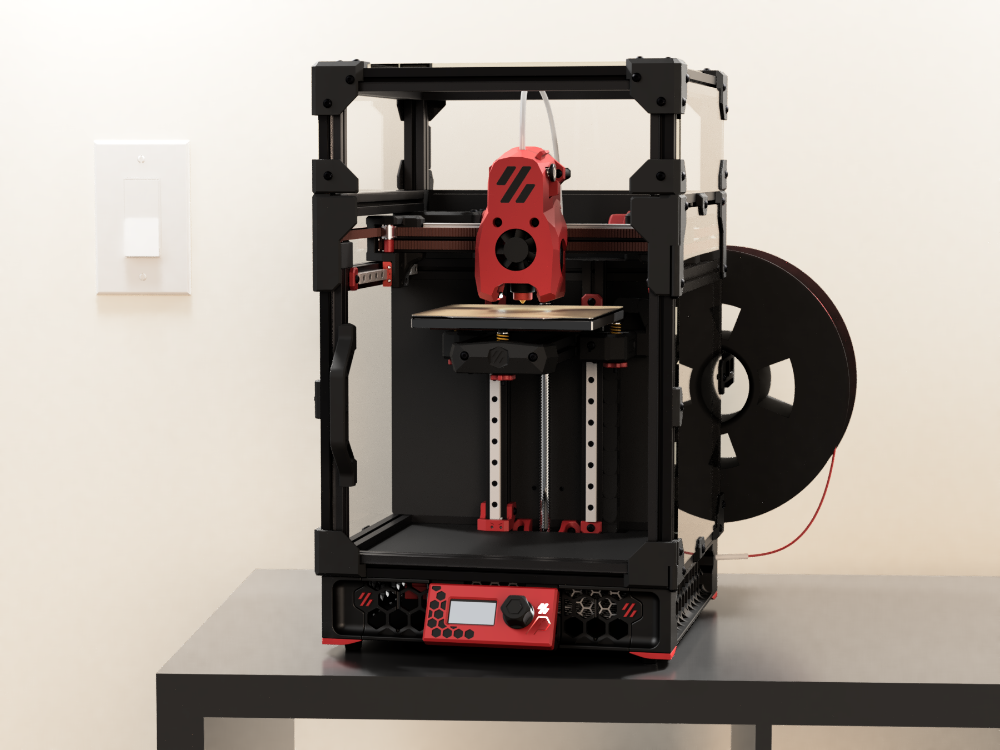
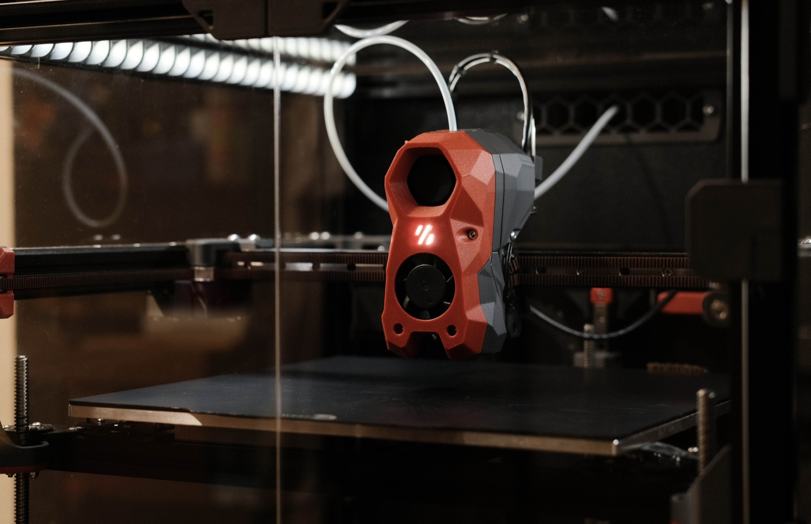
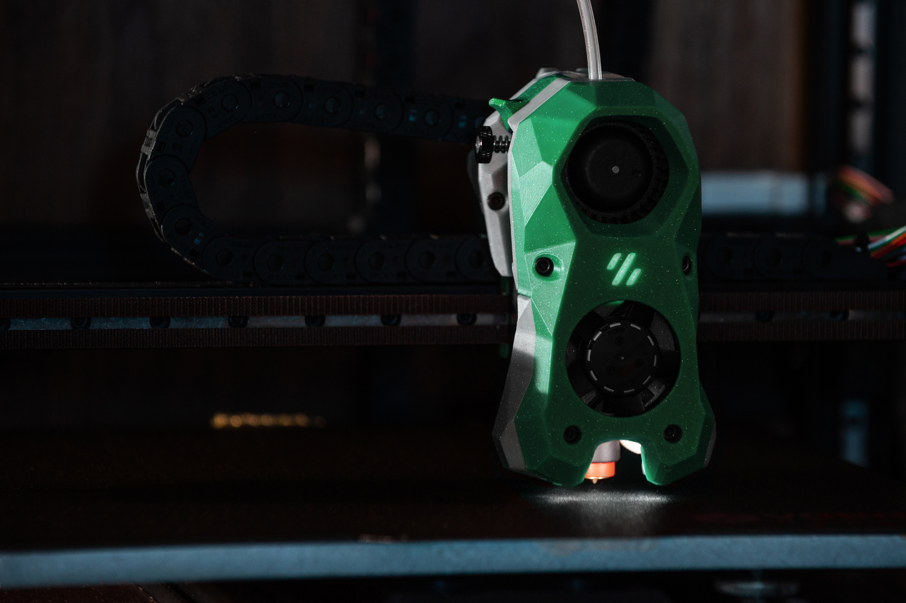
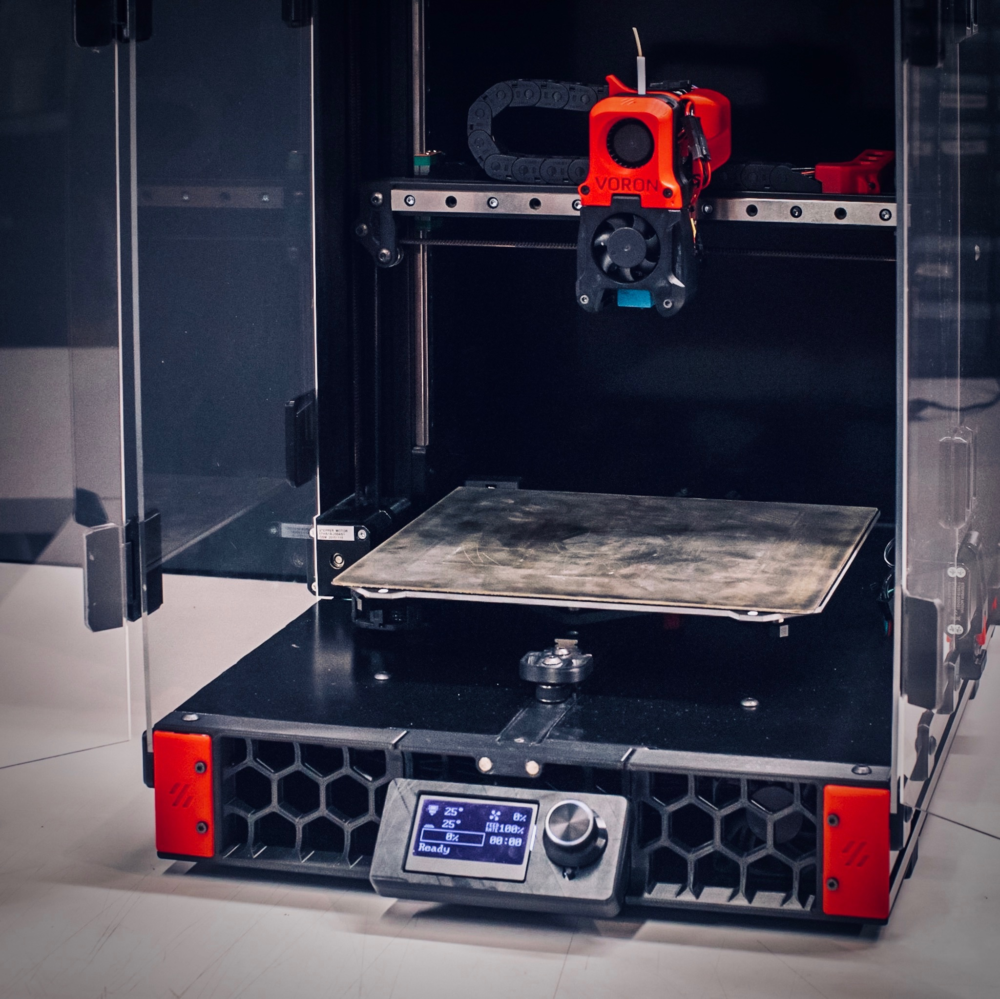
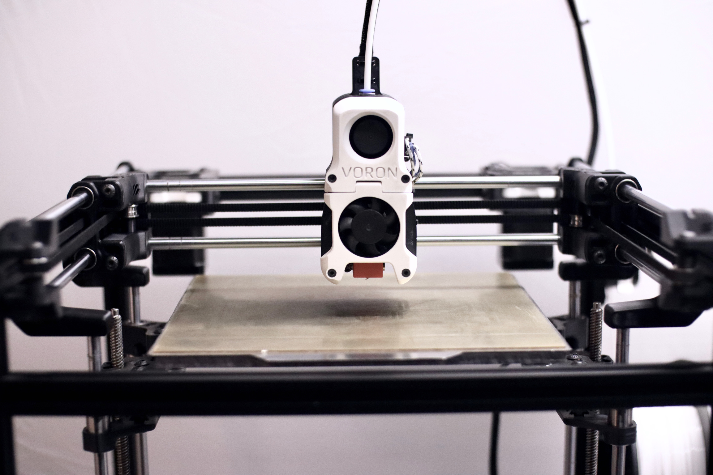
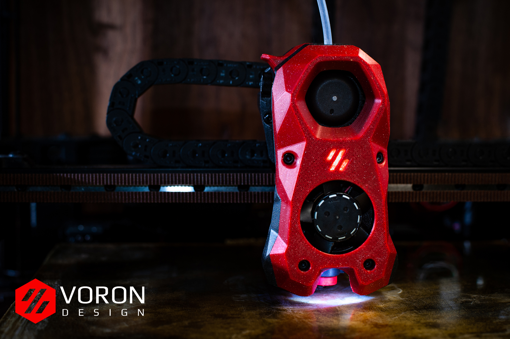
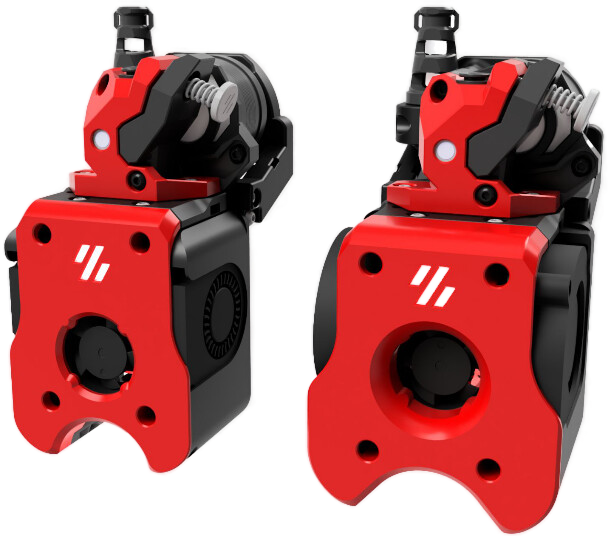
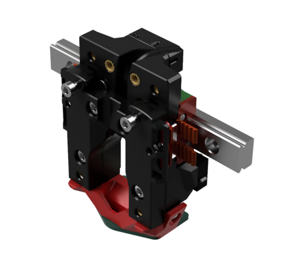
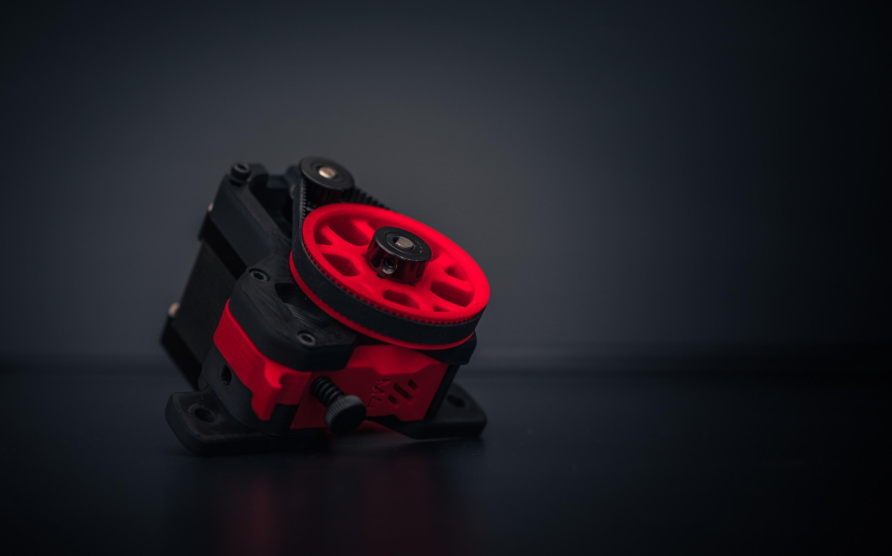
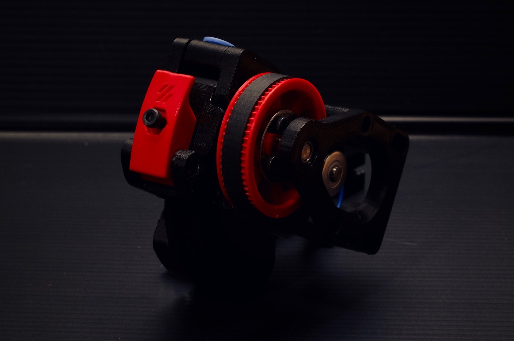

# Choosing a Printer / Toolhead

A guide to choosing your first Voron printer, and the carriage, toolhead and extruder that go with it.

# Printer Models

There are currently five printers in the Voron lineup. None is necessarily better than the others, just different. All printers (except Legacy) are capable of being fully enclosed to print ABS but can just as easily print PLA, PETG, or even Nylon. All printers in the Voron lineup are designed to use a Raspberry Pi linked to one or more motor controller board(s) to manage all of the printer functions and interface controls.

_Note: Pricing estimates are in US Dollars and do not include any necessary tools or other common building supplies. Costs vary widely depending on sourcing, part selection, and shipping costs._

## Voron Zero

The [Voron Zero](https://vorondesign.com/voron0) is a traditional CoreXY design with the bed moving along the Z axis. It has a tiny 120mm³ print area, built with 1515 extrusions. It encloses naturally so printing ABS is possible. Currently, all single mechanical parts for Trident and V2 can be printed on a Voron Zero bed. The design accounts for stock MakerBeam XL extrusion lengths (which come tapped) and standard MGN7 linear rail lengths, so scaling the design increases cost and the labor of tapping extrusions. The bed is also cantilevered, which restricts scaling further. This printer can be built for between \$400 - \$600. Current release is V0.2r1.

[V0 Preview](https://www.youtube.com/watch?v=KR9YlTzWzQQ)

## Voron Trident

The [Voron Trident](https://vorondesign.com/voron_trident) is a traditional CoreXY design with a fixed gantry and the 3-point bed moves along the Z axis. It is simpler to build compared to V2 and can be built for between \$1,000 - \$1,300. It encloses naturally so ABS or other temperature sensitive filaments can be printed easily. It uses linear rails for all axes, driven by belts on the X and Y axes and stepper motors with integrated leadscrews on the Z axis. Standard sizes include a 250x250mm plate, a 300x300mm plate, or a 350x350mm plate. Z height is somewhat restrictive due to the limited options with integrated lead screw steppers, maxing out at 250mm without custom leadscrew motors.

[Trident Homing Routine](https://www.youtube.com/watch?v=iwKfW8ggwE8)

## Voron 2

The [Voron V2](https://vorondesign.com/voron2.4) is a modified CoreXY design with a static bed and a gantry that moves along the Z axis. It is a much more complex build because it includes things such as 4-point gantry tramming to align to the print surface, more stepper motors and other unique features. It is also designed to be fully enclosed so it prints ABS or similar filaments very well. Due to the linear rails the design is scalable in stock form from 250x250x220mm and 300x300x280mm all the way up to 350x350x330mm. More linear rails, larger print surface, and other V2-specific items make this printer more expensive, at between \$1,500 - \$1,900. Current release is V2.4r2.

[V2.4 Quad Level](https://www.youtube.com/watch?v=xfsnEO2VtwM)

## Switchwire

The [Switchwire](https://vorondesign.com/voron_switchwire) is Voron's take on a classic Mendel (aka "bedslinger") design. It is a CoreXZ design so the print head is belt driven in both the X and Z axis eliminating the typical leadscrew Z drive allowing for very fast Z movement speeds and less weight on the gantry by moving the X motor to the frame. The stiff 3030/3060 constructed frame is just large enough to cover the entire swing of the Prusa 250x210mm bed and allows for a natural enclosure. If you don't have an existing Prusa printer to pull parts from, expect to spend between \$700 - \$900.

[Switchwire Introduction Video](https://www.youtube.com/watch?v=jwPLl1v5ae4)

## Legacy

The [Legacy](https://vorondesign.com/voron_legacy) is a tribute to the roots of the Voron project and the RepRap project. It returns to the classic design using LM8UU rods and bearings in the 230mm³ size but retains the Afterburner toolhead. It is not designed to be enclosed. The electronics enclosure is very small, adding to the open-air vibe. Costs are variable depending on the builder's old stock of LM8UU components but are expected to be between \$600 - \$800.

[Legacy Introduction Video](https://www.youtube.com/watch?v=NZqvRLa8ShE)

# Toolheads, Carriages and Extruders

## Toolheads

### Stealthburner

Stealthburner is not specifically an extruder, but the collective name for the Voron direct-drive interchangeable toolhead system. The Stealthburner system has three interchangeable components: the extruder, the toolhead holding the hotend, and the cooling assembly. Each of those can be swapped without affecting the other components.

[Stealthburner Announcement Video](https://www.youtube.com/watch?v=lnMJBdUXuH4)

### Mini Stealthburner

Mini Stealthburner refers to the V0.2 toolhead with a built-in direct-drive extruder. It is the successor to the Mini Afterburner toolhead.

### DownDraft

DownDraft is a modular, adjustable performance toolhead for the Trident, V2, Switchwire and Legacy. It uses the Clockwork 2 mounting pattern, including compatible Tap mounts.

It accepts a wide range of common hotends and keeps toolhead height and nozzle position constant across all of them, so changing a hotend never requires a reprint. Orbiter v2 extruders mount directly. Other patterns need an adapter spacer.

Choose between two part-cooling variants:

- **Dual 4010 blowers:** slimmer and lighter, suitable for every filament.
- **Dual 5015 blowers:** wider, with more airflow for fast or high-flow printing.

Both variants use a 2510 hotend fan and share extruder and PCB mounts. The logo lights with a single Neopixel or the Rainbow Barf LED.

## Carriages

### Chariot

Chariot is the Voron X carriage. It sits 1.6 mm closer to the rail than earlier carriages, moving the toolhead's center of mass inward, and slides onto an MGN12 carriage from either side for a stiffer toolhead connection.

Toolheads attach in the Stealthburner / Clockwork 2 / DownDraft style. Built-in mounts hold Beacon and Cartographer eddy current probes, BTT Eddy/Omron style probes, Klicky and PINDA. Builders who probe with the nozzle can omit the probe mount. Belt clips roll into the carriage and stay adjustable after assembly.

{: style="display: block; margin: 0 auto;" }

## Extruders

### Mobius (M4)

Mobius is the original Bowden extruder for Voron printers, designed to be mounted on the frame. It is highly optimized, uses dual gears, and is very effective for Bowden setups. It is driven by a full-size or a compact "pancake" NEMA17 motor.

[M4 Introduction Video](https://www.youtube.com/watch?v=H2RBZYDZgTQ)

### Jetpack

Jetpack is a modified Mobius designed to be mounted on the X axis for a shorter Bowden. It was designed as an interim solution to reduce the Bowden tube lengths before the introduction of Afterburner and has been superseded by the M4. It is driven by a compact "pancake" NEMA17 motor.

### Clockwork 2.5

Clockwork is the successor to the original Afterburner extruder, adapted for Stealthburner. It is a repackaged BMG dual-gear extruder driven by a compact "pancake" NEMA14 motor. Version 2.5 adds a choice of Bowden collet or ECAS04 fitting, a gear inspection window, and an optional built-in filament sensor. People commonly, but incorrectly, call this extruder "Stealthburner."

### Nightwatch

Nightwatch is the Clockwork 2 repackaged for the smaller size needed by the Voron Zero printer. Nightwatch is available as a [standalone extruder](https://github.com/VoronDesign/Pocket-Watch/) for Bowden setups.

### Galileo

Galileo is an extruder for the Afterburner toolhead, the predecessor to Stealthburner. It is based on the [Orbiter](https://www.thingiverse.com/thing:4223085) extruder and adds a planetary gear reduction, which allows a smaller housing and a lighter motor.

_Note: While not a Voron product, the Bondtech LGX is a drop-in fit on the Afterburner system._

---

### Next: [Sourcing Information](./sourcing.md)
